Buying for a hockey fan is easy until you realize he already owns six jerseys and a drawer full of toques. This guide sorts gift ideas by budget so you can grab something he'll actually wear, use or put on the shelf before Christmas.

It's hard to shop for guys, especially this time of year. Yet, we've got a great line up of items for the hockey man in your life, that he'll love at home, the bar, or the arena. Check them out!

Every pick below is sorted into four price tiers, from stocking stuffers to splurge gifts. Prices change fast this time of year, so check the listing before you buy.

## Under $25: stocking stuffers that don't feel cheap

Small gifts work best when they match what he does on game night. Think things he'll use before the puck drops.

[BenShot Hockey Puck Pint Glass (16oz)](https://www.amazon.com/dp/B08FKXNNPB?tag=thatfootbal01-20). For the guy who hosts game night. The puck is set right into the middle of the glass, like a slapshot that hit it. (It's the glass in the photo at the top of this post.)

A 16oz pint glass with a real hockey puck set into its side. It's made in the USA and comes in its own gift box.

**Best for:** the hockey fan who likes a cold one.

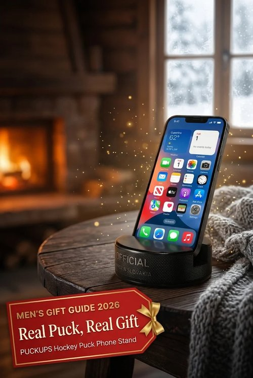 {small}

[PUCKUPS Genuine Hockey Puck Phone Stand](https://www.amazon.com/dp/B00E37SQ84?tag=thatfootbal01-20). A real puck turned into a desk or nightstand stand.

A very sturdy phone stand made from a real regulation hockey puck. It holds most phones upright on a desk.

**Best for:** the hockey player at his desk.

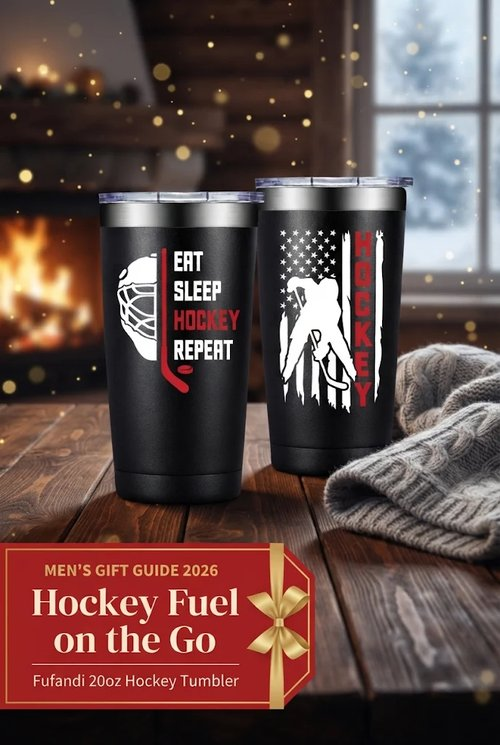 {small}

[Fufandi Hockey 20oz Insulated Tumbler](https://www.amazon.com/dp/B0FK1VYVQP?tag=thatfootbal01-20). Coffee before the game, stays hot through the second period.

A 20oz stainless steel, double-wall vacuum-insulated tumbler that keeps drinks hot or cold. A hockey-themed gift for coaches and fans.

**Best for:** the hockey coach or rink regular.

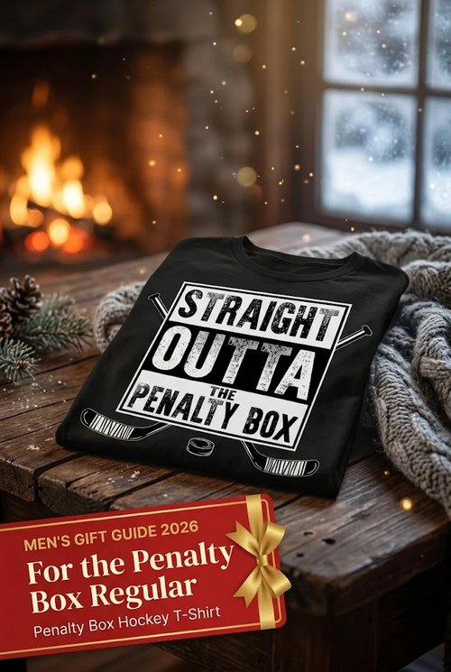 {small}

[Straight Outta The Penalty Box Hockey T-Shirt](https://www.amazon.com/dp/B079T32H5X?tag=thatfootbal01-20). The funny one for the guy who spends more time in the box than on the ice.

A funny penalty-box graphic tee for hockey players and fans. An easy, low-cost gift.

**Best for:** the hockey player who spends time in the box.

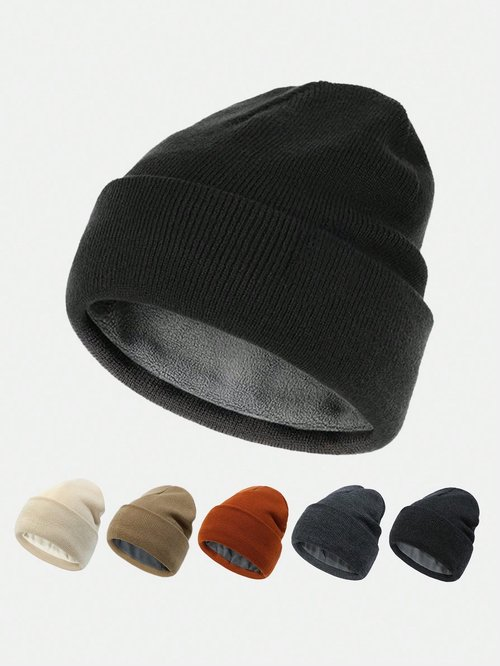 {small}

[Thermal-Lined Knit Beanie](https://onelink.shein.com/57/659ral2t08lk?ismg_ol=2IRVS0bymtU_01_KOC-C). A toque that's actually lined, for cold arenas and colder driveways.

A thick, thermal-lined knit beanie that's warm enough for cold stadium seats and plain enough to go with any team's colours. Grab a couple in different shades.

**Best for:** the gameday guy.

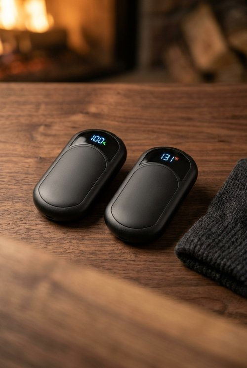 {small}

[ropelux Rechargeable Hand Warmers (2-pack)](https://www.amazon.ca/dp/B0FSKK9G5F?tag=thatfootballg-ca-20). A small add-on that fits in a stocking and gets used all winter.

A two-pack of rechargeable hand warmers with big 6400mAh batteries. Toss them in his pockets for cold games, walks and commutes.

**Best for:** the cold-hands guy.

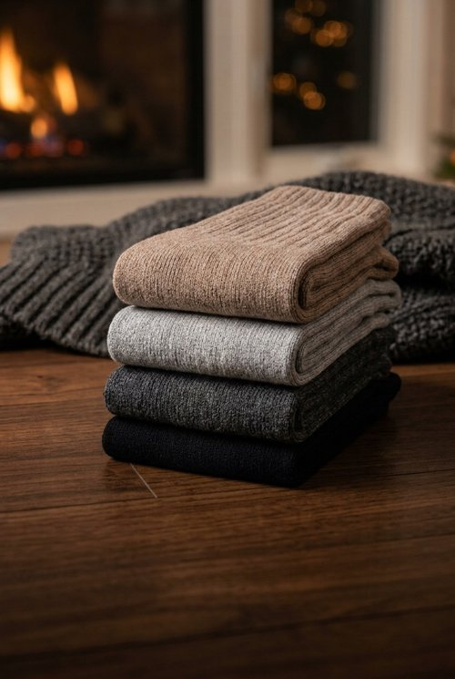 {small}

[EBMORE Merino Wool Thermal Socks](https://www.amazon.ca/dp/B0CW2TQFPS?tag=thatfootballg-ca-20). Unglamorous, but he'll thank you in January.

A multi-pack of merino wool thermal socks in brown, grey and black. Merino is warm, breathable and naturally fights odour, so they're as good for a cold stadium as they are for a winter commute. A practical gift every guy will actually use.

**Best for:** the cold-stadium guy.

## $25 to $60: the gifts he'll wear all winter

This is the sweet spot for most gift lists. These are pieces that work on game night and in everyday life.

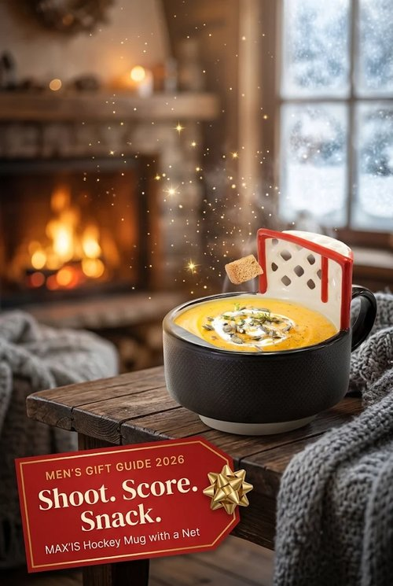 {small}

[MAX'IS Creations Hockey Mug with a Net (14oz)](https://www.amazon.com/dp/B016P4UZ5Y?tag=thatfootbal01-20). The one hockey-specific gift in this tier, and it looks good on a shelf.

A hand-painted stoneware mug with a net he can shoot snacks into. It doubles as a cereal bowl and makes a fun desk or kitchen gift for hockey fans.

**Best for:** the hockey fan with a sense of humour.

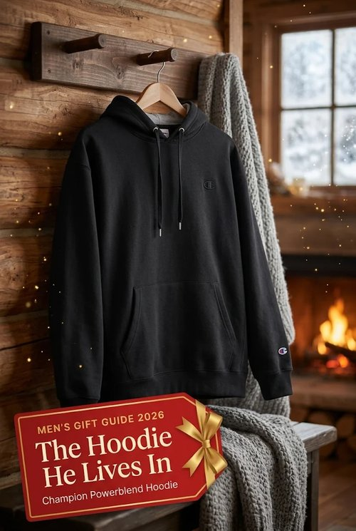 {small}

[Champion Men's Powerblend Pullover Hoodie](https://www.amazon.com/dp/B01HIUTCA8?tag=thatfootbal01-20). Plain enough to wear anywhere, warm enough for the rink.

Champion's midweight brushed Powerblend fleece, which resists pilling and shrinking. It has a roomy kangaroo pocket and a double-lined drawcord hood.

**Best for:** the guy who lives in hoodies.

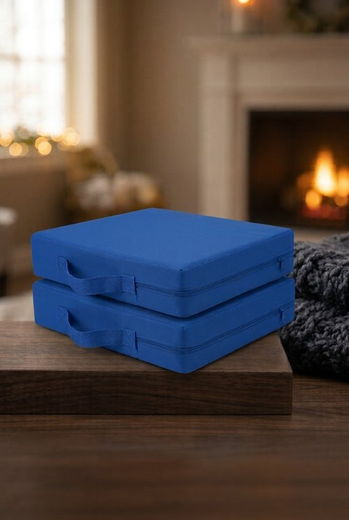 {small}

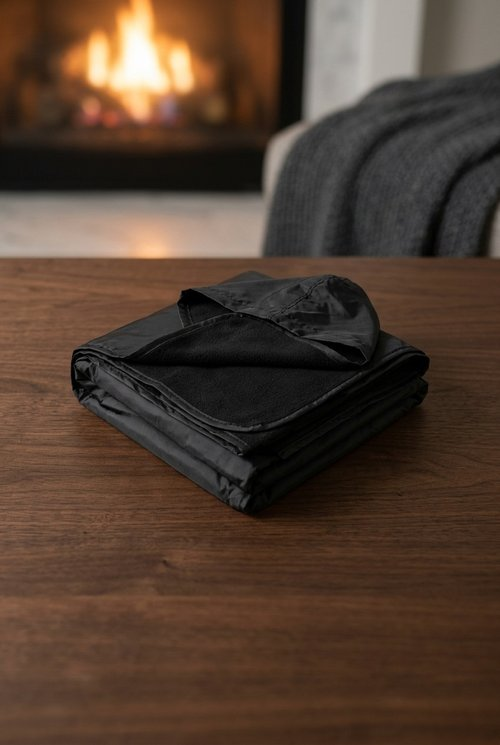 {small}

[FASTMOMENT Stadium Seat Cushions (2-pack)](https://www.amazon.ca/dp/B0D9XWMVN7?tag=thatfootballg-ca-20) or the [DUKUSEEK Hooded Stadium Blanket](https://www.amazon.ca/dp/B091GMCBBG?tag=thatfootballg-ca-20). For anyone who sits through cold arena games.

*FASTMOMENT Stadium Seat Cushions (2-pack):* A two-pack of padded stadium seat cushions with carry handles, made for long games on hard bleachers. A gift for him and whoever's sitting next to him. **Best for:** the stadium regular.

*DUKUSEEK Hooded Stadium Blanket:* A hooded, waterproof stadium blanket with a fleece lining, made to wrap around him at cold games, tailgates and campsites. It's warmer than a regular throw and packs up easily. **Best for:** the cold-stadium guy.

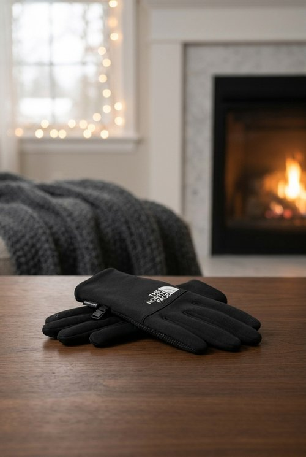 {small}

[The North Face Etip Recycled Touchscreen Gloves](https://www.amazon.ca/dp/B08BDPDNH7?tag=thatfootballg-ca-20). He can still use his phone to check the score.

The North Face Etip gloves, made with recycled materials and touchscreen-friendly fingertips so he can use his phone without taking them off. A warm, everyday glove from a brand he'll recognise.

**Best for:** the winter commuter.

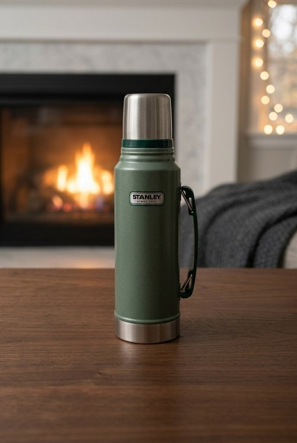 {small}

[Stanley Heritage Classic Vacuum Bottle 1.1 qt](https://www.amazon.ca/dp/B000FZX93K?tag=thatfootballg-ca-20). The classic thermos for the early-morning rink run.

The Stanley Classic vacuum bottle in Hammertone Green, the original keeps-coffee-hot thermos. Built for tailgates, job sites and early mornings, and tough enough to last for years.

**Best for:** the tailgater.

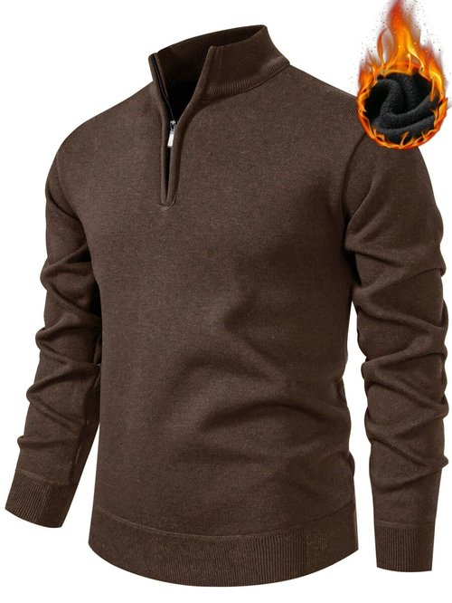 {small}

[Manfinity Homme Thermal Lined Quarter Zip Pullover](https://onelink.shein.com/58/65zgbh3itf7h?ismg_ol=4LifJIaP0tf_01_KOC-C). A warm layer that dresses up or down.

A thermal-lined quarter-zip pullover in coffee brown, warm enough for cold games and sharp enough for the office.

**Best for:** the gameday layering guy.

## $60 to $100 and splurge $100+: the gifts that get remembered

If the budget stretches, go for one real piece over three small ones.

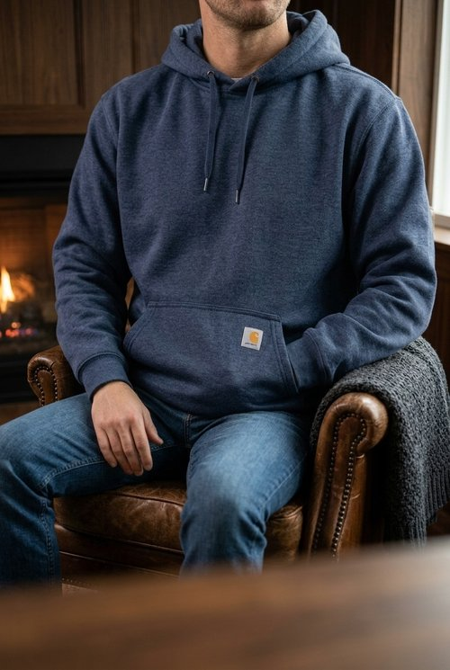 {small}

[Carhartt Loose Fit Midweight Logo Sleeve Hoodie](https://www.amazon.ca/dp/B00778BNEA?tag=thatfootballg-ca-20) ($60 to $100). Heavyweight and built to last.

Carhartt's loose fit midweight hoodie with the logo on the sleeve. It's heavy enough for fall, built to last and the hoodie every guy ends up wearing to death.

**Best for:** literally any guy.

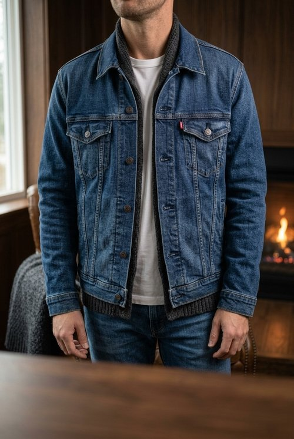 {small}

[Levi's Trucker Jacket](https://www.amazon.ca/dp/B077TDS2G6?tag=thatfootballg-ca-20) ($60 to $100). A jacket that works every season.

The Levi's Trucker jacket, the original denim jacket in a stretch wash. It layers over a hoodie in fall and a tee in spring, and it's one of those pieces a guy keeps for a decade.

**Best for:** the layering guy.

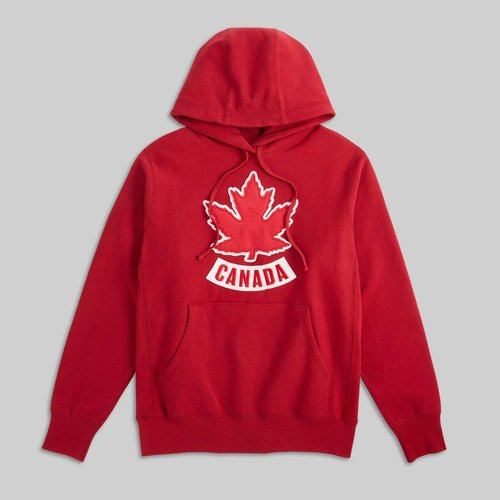 {small}

[House of Blanks Vintage Maple Leaf Hooded Pullover](https://www.awin1.com/cread.php?awinmid=117971&awinaffid=2968527&ued=https%3A%2F%2Fwww.houseofblanks.com%2Fproducts%2Fvintage-maple-leaf-hooded-pullover-red) ($100+). Made in Canada, and a good pick for the hockey fan who wants his gear to look good.

House of Blanks' vintage maple leaf hoodie in red, with a felt maple leaf on the chest. Made in Canada, and perfect for hockey nights.

**Best for:** the guy who's proud to be Canadian.

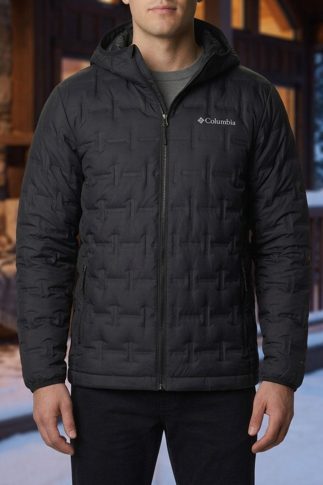 {small}

[Columbia Delta Ridge II Down Jacket](https://www.amazon.ca/dp/B0CLR8R792?tag=thatfootballg-ca-20) ($100+). Warm enough for the walk from the parking lot to the arena.

The Columbia Delta Ridge II, a down hooded jacket with a clean, stitch-free design. Serious warmth for late-season games without the puffy look.

**Best for:** the cold-stadium guy.

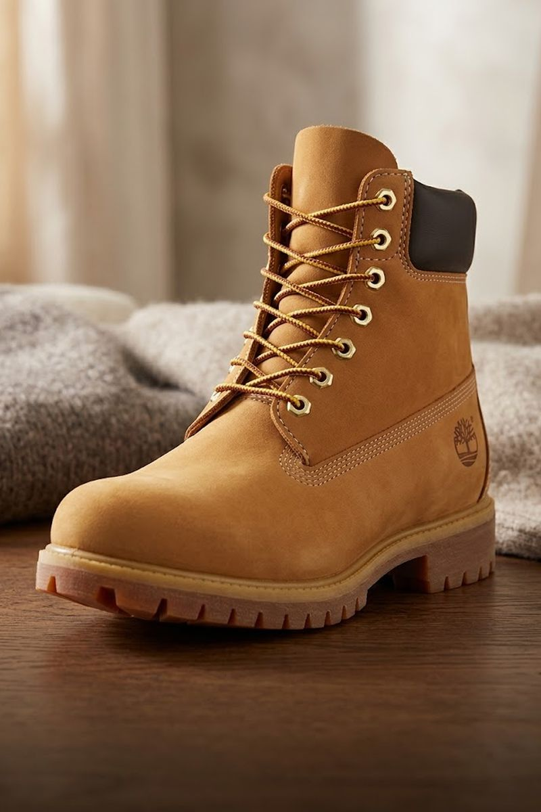 {small}

[Timberland Premium 6" Waterproof Boot](https://www.amazon.ca/dp/B0CPSKXWT1?tag=thatfootballg-ca-20) ($100+). The boot he'll wear until it falls apart.

The Timberland Premium 6-inch waterproof boot in wheat nubuck, the original tailgate boot. Waterproof, built for snow and slush, and recognisable everywhere. A gift he'll wear for years.

**Best for:** the gameday guy (go big).

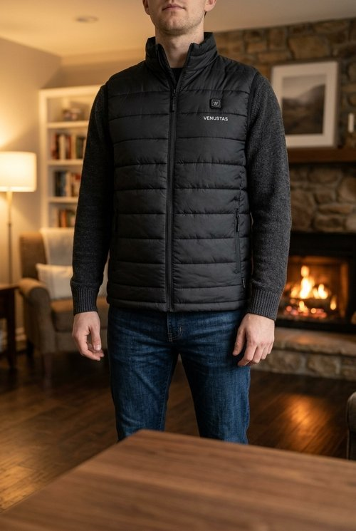 {small}

[Venustas Heated Vest with Battery](https://www.amazon.ca/dp/B08F4WXBJS?tag=thatfootballg-ca-20) ($100+). For the guy who's always cold at outdoor games.

A heated vest with a rechargeable battery and multiple heat settings, in black. It slips under a jacket for cold games, ice fishing or shovelling, and comes in sizes up to 5XL.

**Best for:** the cold-stadium guy (go big).

## How to wear it: a hockey night outfit

You don't need a jersey to dress for hockey night. Start with the [House of Blanks 3016 recycled cotton pullover](https://tidd.ly/3UIQG9j) in charcoal, throw the [Levi's Sherpa Trucker Jacket](https://www.amazon.com/dp/B0F9ZDLH5H?tag=thatfootbal01-20) over it, and finish with an officially licensed [NHL pom beanie](https://www.amazon.com/dp/B0DCT55QZM?tag=thatfootbal01-20) in his team's colours, and you're set.

")

{{product gameday/gameday-nov-23-5/pullover}}
{{product streetwear/streetwear-outfit-nov-16/trucker-jacket}}
{{product gameday/gameday-nov-23-5/nhl-pom-beanie}}

It's warm enough for the arena, comfortable enough for the couch, and sharp enough to wear to the bar after the game. Not bad for one outfit.

## Wrap-up

Pick one gift from the tier that fits your budget, add a small stocking stuffer, and you're covered. Last day to order for Christmas delivery varies by seller, so check shipping dates before you buy.
