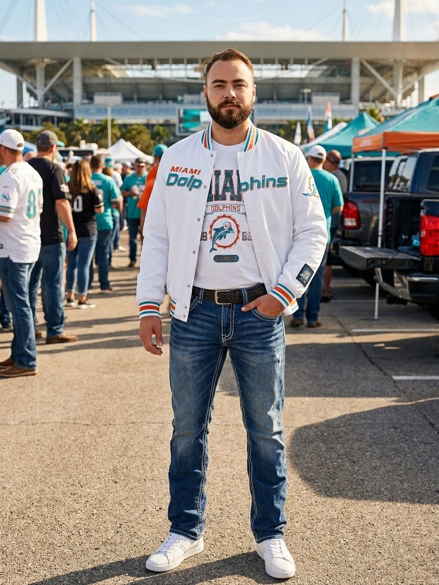

This is a **test post**. It exists to exercise every feature of the blog template and is never published. Real posts start with a short intro like this one, which sits above the table of contents.

A second intro paragraph with a link to the [gameday outfits](/outfits/gameday/) and the [shop grid](/products/).

## Start with a layer you can take off

Stadium weather changes fast. A hoodie over a tee handles a cold kickoff and a warm second half.

{{product gameday/gameday-pink-out-bold-oct-7/hoodie}}
{{product gameday/gameday-sept-10/jacket}}

The SHEIN hoodie is {{price gameday/gameday-pink-out-bold-oct-7/hoodie}} right now, pulled straight from the catalog.

## Pick shoes you can stand in all day

- Broken-in sneakers beat new ones
- Skip anything white if it might rain
- Thick socks for a cold night game

## Keep it to one team colour

Pick one colour from the team and let the rest stay neutral:

1. Team colour on top
2. Dark denim
3. Neutral shoes

### When to go full kit

On rivalry weekends. Otherwise, one piece says enough.

## FAQ

### What should I wear to a football game in the cold?

Layers: a tee, a hoodie and a jacket you can tie around your waist, plus a beanie.

### Can I wear a team jacket instead of a jersey?

Yes. A licensed satin or bomber jacket reads as fan gear and is warmer than a jersey.
